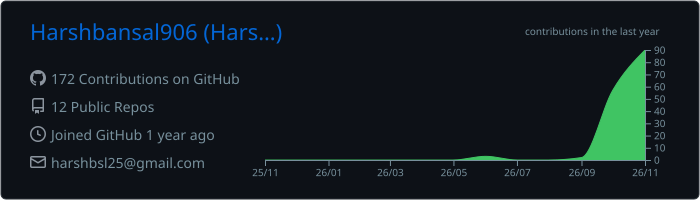

<!-- ==================== HEADER ==================== -->
<div align="center">


<h2>Building. Learning. Improving.</h2>


<br/><br/>

<a href="https://github.com/Harshbansal906?tab=repositories">
  
</a>

<br/><br/>

**Computer Science Student | Problem Solver | Aspiring Developer**

*Focused on mastering fundamentals and building practical software.*

</div>

---

### 👨‍💻 About Me

Hey, I'm **Harsh Bansal**, a B.Tech Computer Science and Engineering student specializing in **Artificial Intelligence**.

I enjoy writing code, understanding how programs work under the hood, and building functional web projects.

- 🔭 **Currently Building**:
  - **Readora** — A clean editorial publishing platform.
  - **VoiceGuard AI** — Voice and audio analysis project.
- 💻 **Languages I Use**: Java, Python, JavaScript, HTML, CSS.
- 🛠️ **Tools**: Git, GitHub, VS Code.
- 🌱 **Currently Practicing**: Problem solving and strengthening core programming concepts.

```java
public class Harsh {

    static final String NAME = "Harsh Bansal";
    static final String FIELD = "Computer Science (AI)";

    String[] focus = {
        "Java",
        "Python",
        "Web Development",
        "Problem Solving"
    };

    String mindset() {
        return "Learn deeply. Build consistently. Improve every day.";
    }
}
```

---

### 🛠️ Tech Stack & Tools

<div align="center">
  
</div>

---

### 📊 GitHub Analytics

<div align="center">

<a href="https://github.com/Harshbansal906">
  
</a>
<a href="https://github.com/Harshbansal906">
  
</a>

</div>

---

### 📬 Connect With Me

<div align="center">

<a href="https://github.com/Harshbansal906">
  
</a>
<a href="https://www.linkedin.com/in/harsh-bansal-8367912bb">
  
</a>
<a href="mailto:harshbsl25@gmail.com">
  
</a>

</div>

---

<div align="center">

*Consistency over perfection. Keep learning. Keep building. Keep improving.*


</div>

### 📊 Activity & Contribution Overview

<p align="center">
  
  
</p>
