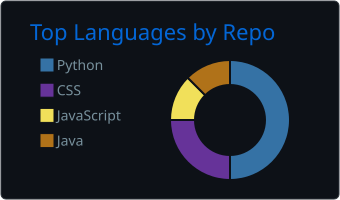

<!-- ==================== HEADER ==================== -->
<div align="center">


<h2>Building. Learning. Engineering.</h2>


<br/><br/>

<a href="https://github.com/Harshbansal906">
  
</a>
<a href="https://github.com/Harshbansal906?tab=followers">
  
</a>
<a href="https://github.com/Harshbansal906?tab=repositories">
  
</a>

<br/><br/>

**Computer Science Student | Problem Solver | AI & Full-Stack Enthusiast**

*I enjoy understanding how systems work and turning ideas into practical software solutions.*

</div>

---

### About Me

Hey, I'm **Harsh Bansal**, a B.Tech Computer Science and Engineering student specializing in **Artificial Intelligence**.

I'm interested in more than just writing code. I enjoy understanding how complex software systems operate under the hood, experimenting with modern technologies, solving algorithmic challenges, and building high-performance applications that deliver real value.

- 🔭 **Currently Building**:
  - **Readora** — A modern, high-performance editorial publishing platform with seamless writing ergonomics and reader-first aesthetics.
  - **VoiceGuard AI** — Deepfake voice detection and audio analysis system leveraging machine learning.
- 💡 **Core Interests**: Data Structures & Algorithms, Full-Stack Architecture, and Applied Artificial Intelligence.
- ☕ **Programming Languages**: Java, Python, JavaScript, C, SQL.
- 🌱 **Current Focus**: Mastering advanced algorithms, backend design patterns, and distributed system fundamentals.
- 🎯 **Philosophy**: *Learn deeply. Build consistently. Improve every day.*

```java
public class Harsh {

    static final String NAME = "Harsh Bansal";
    static final String FIELD = "Computer Science (AI)";

    String[] interests = {
        "Software Engineering",
        "Data Structures and Algorithms",
        "Full-Stack Web Development",
        "Artificial Intelligence",
        "System Design & APIs",
        "Problem Solving"
    };

    String mindset() {
        return "Learn deeply. Build consistently. Improve every day.";
    }
}
```

---

### 🚀 Current Focus

<table>
<tr>
<td width="50%" valign="top">

#### 🧠 Problem Solving
- Data Structures & Algorithms in Java & Python
- Recursion, Backtracking & Dynamic Programming
- Graph Traversals (BFS/DFS), Trees, Hashing
- Writing clean, time- and space-optimal code

</td>
<td width="50%" valign="top">

#### 💻 Full-Stack & Systems
- RESTful API design & backend routing
- Node.js, Express & modern vanilla JS architectures
- Database modeling, state synchronization & UI workflows
- Clean code architecture and responsive UI/UX

</td>
</tr>
</table>

---

### 🛠️ Tech Stack

<div align="center">
  
</div>

<br/>

<div align="center">
  
  
  
  
</div>

---

### 📊 GitHub Analytics

<div align="center">

<a href="https://github.com/Harshbansal906">
  
</a>
<a href="https://github.com/Harshbansal906">
  
</a>

<br/><br/>

<a href="https://github.com/Harshbansal906">
  
</a>

</div>

---

### 📬 Connect With Me

<div align="center">

<a href="https://github.com/Harshbansal906">
  
</a>
<a href="https://www.linkedin.com/in/harsh-bansal-8367912bb">
  
</a>
<a href="mailto:harshbsl25@gmail.com">
  
</a>

</div>

---

<div align="center">

*Consistency over perfection. Keep learning. Keep building. Keep improving.*


</div>

I'm a Computer Science student passionate about building projects, solving problems, and learning new technologies.

- 💻 Practicing Data Structures & Algorithms
- 🌐 Exploring Web Development
- 🤖 Interested in Artificial Intelligence and Machine Learning
- 🚀 Building and improving real-world projects

### 🛠️ Technologies I'm Learning

- **Languages:** Java, Python
- **Web:** HTML, CSS, JavaScript
- **Interests:** DSA, AI/ML, Software Development

### 📌 Featured Projects

- **VoiceGuard AI** — Voice analysis and AI project
- **Readora** — Article-sharing web application

### 🎯 Current Goals

- Strengthen my DSA fundamentals
- Build practical software projects
- Prepare for software development internships

### 🤝 Connect With Me

- Linkedin - https://www.linkedin.com/in/harsh-bansal-5b1bb836b?utm_source=share_via&utm_content=profile&utm_medium=member_android
- <div align="center">

### 📈 GitHub Analytics & Contribution Metrics

<!-- Profile View Counter Badge -->
<p>
  
</p>

<!-- GitHub Overall Stats & Most Used Languages -->
<p>
  
  
</p>

<!-- GitHub Streak Analytics -->
<p>
  
</p>

</div>
### 📊 Activity & Contribution Overview

<p align="center">
  
  
</p>
